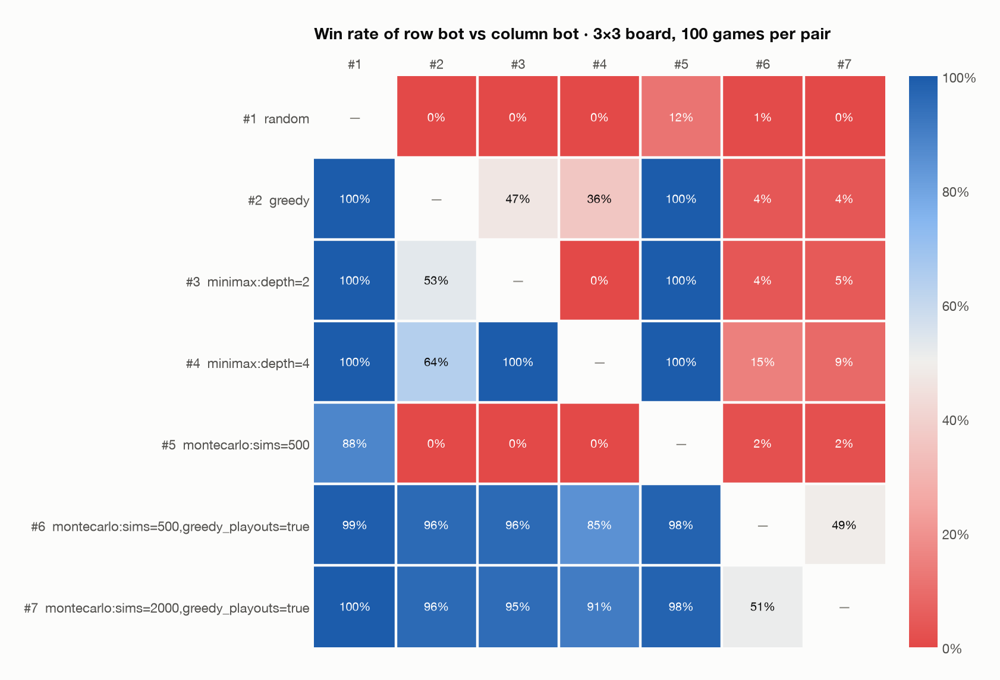
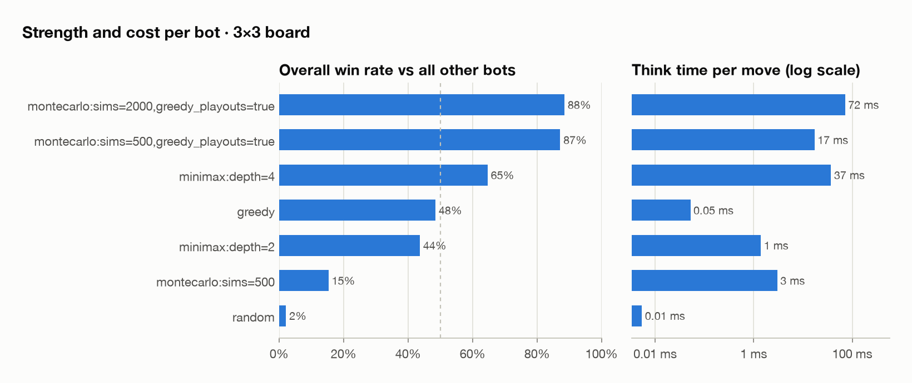
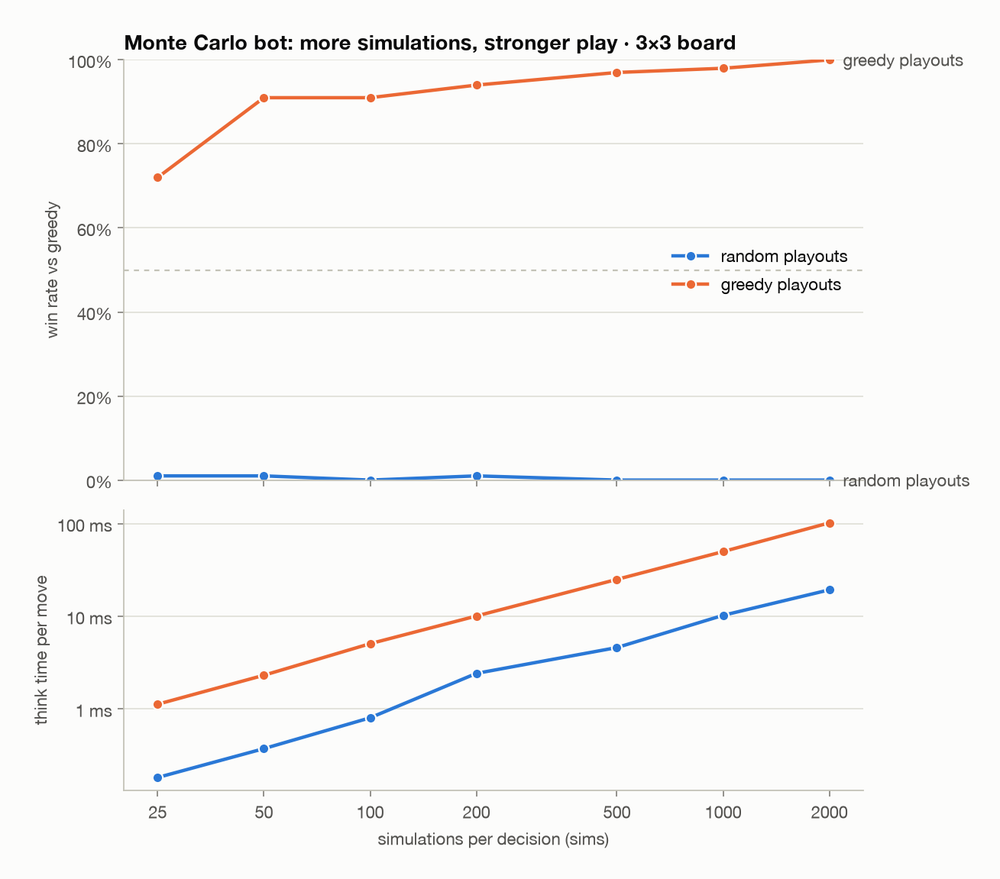

# Person 2 measured results: Monte Carlo bot and arena

**Headline:** the Monte Carlo bot with greedy playouts is the strongest bot we have on 3×3.
`montecarlo:sims=500,greedy_playouts=true` beats greedy 96% of the time and minimax depth 4
85% of the time, and takes about 17 ms per move. With random playouts the same bot is
weaker than greedy at every `sims` value we tried.

All numbers are seeded and reproducible (`--seed 0`). They are local measurements, not a
universal strength claim. The raw data is in the CSV files next to this note.

## Arena: every bot against every bot (3×3, 100 games per pair)





| Bot | Overall win rate | Think time per move |
|---|---|---|
| `montecarlo:sims=2000,greedy_playouts=true` | 88.5% | 72 ms |
| `montecarlo:sims=500,greedy_playouts=true` | 87.2% | 17 ms |
| `minimax:depth=4` | 64.7% | 37 ms |
| `greedy` | 48.5% | 0.05 ms |
| `minimax:depth=2` | 43.7% | 1.4 ms |
| `montecarlo:sims=500` (random playouts) | 15.3% | 3 ms |
| `random` | 2.2% | 0.005 ms |

How it was run: `uv run python -m dnb.arena.run_arena --charts`. The bots swap who moves
first every game, and every game gets its own seed. Overall win rate is over 600 games
(6 opponents × 100). A draw counts as half a win. Think time is measured inside each game,
so running games in parallel does not change it.

**Caveat on minimax vs minimax:** both minimax bots are deterministic, so their pair only has
two distinct games (one per starting player), each replayed 50 times. That is why that cell
shows exactly 0% / 100%. Every other pair involves at least one randomised bot.

## Monte Carlo strength vs `sims` (against greedy, 3×3, 100 games per point)



| sims | Random playouts: win rate | ms/move | Greedy playouts: win rate | ms/move |
|---|---|---|---|---|
| 25 | 1% | 0.2 | 72% | 1.1 |
| 50 | 1% | 0.4 | 91% | 2.3 |
| 100 | 0% | 0.8 | 91% | 5.0 |
| 200 | 1% | 2.4 | 94% | 10 |
| 500 | 0% | 4.6 | 97% | 25 |
| 1000 | 0% | 10 | 98% | 50 |
| 2000 | 0% | 19 | 100% | 102 |

How it was run: `uv run python -m dnb.arena.sweep`. Think time grows linearly with `sims`.

## What this means

* **The playout policy matters far more than the number of playouts.** In a random playout
  nobody takes the free boxes that are offered, so giving a box away looks harmless and the bot
  learns to do it. Against greedy, which always takes free boxes, it loses almost every game
  however many playouts it runs. Greedy playouts punish those gifts, so even 50 playouts per
  decision beat greedy 91% of the time.
* **`sims` is a smooth strength dial** once playouts are greedy: 25 → 2000 sims moves the win
  rate against greedy from 72% to 100%. Person 3 can use this for difficulty levels.
* **Monte Carlo beats depth-4 minimax at a similar cost.** Minimax only scores boxes won so
  far in a few-move window. The playouts see the end of the game, including long chains.

## Notes for teammates

* **Person 3 (levels):** the current Expert level `montecarlo:sims=2000,greedy_playouts=true`
  is the strongest bot measured. `sims=500,greedy_playouts=true` is almost as strong at a
  quarter of the cost. For in-between levels, low `sims` with greedy playouts (25-50) sits
  between greedy and the top bots. `montecarlo` with random playouts is a good "Easy"
  option: it beats random 88% of the time but loses to everything else.
* **Person 4 (hints):** Monte Carlo is now stronger than minimax at playing. Its
  `evaluate_moves` scores are win rates (`2 * win_rate - 1`), so they are noisy at low `sims`
  and less suited to labelling single moves than minimax's exact box margins. Worth trying for
  the hint button; probably keep minimax for the review.
* **Person 5 (server):** time to pick a move from the empty board with
  `sims=2000,greedy_playouts=true`: about 55 ms on 3×3, 100 ms on 4×4, 170 ms on 5×5 and
  400 ms on 7×7 (Apple Silicon laptop). It gets faster as the board fills.

## Reproduce or extend

```bash
uv run python -m dnb.arena.run_arena --charts                         # this table, 3×3
uv run python -m dnb.arena.run_arena --rows 4 --cols 4 --games 50     # other board sizes
uv run python -m dnb.arena.run_arena --specs greedy "montecarlo:sims=100,greedy_playouts=true"
uv run python -m dnb.arena.sweep --opponent "minimax:depth=4"         # sims sweep vs minimax
uv run python -m dnb.arena.charts results/arena_3x3_pairs.csv         # redraw without replaying
```
